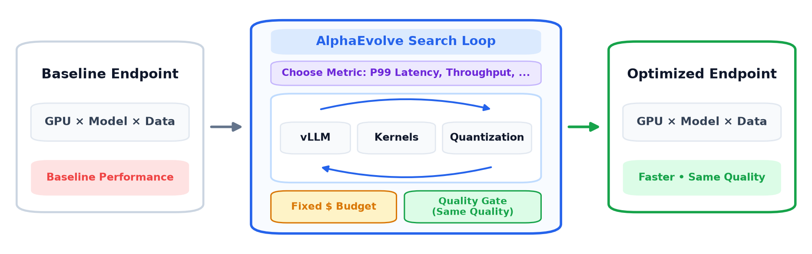

# `alpha_inference`: Autonomous AI Inference Optimization with Google Cloud AlphaEvolve
### Automatically tune `vLLM`, GPU kernels, CUDA graphs, and quantization for your exact `GPU × Model × Workload` — with zero quality loss

<p align="center">
  
</p>

`alpha_inference` connects [**Google Cloud AlphaEvolve**](https://cloud.google.com/blog/products/ai-machine-learning/alphaevolve-is-available-for-everyone) ([docs](https://docs.cloud.google.com/gemini/enterprise/docs/alphaevolve/developer-guide/overview) · [code examples](https://github.com/Google-Cloud-AI/alphaevolve-on-googlecloud/tree/main/examples)) to any **Vertex AI GPU Endpoint** (or **GPU VM**) to automatically discover faster `vLLM` inference flags, quantization settings, CUDA graph capture ladders, runtime backends, and custom `@triton.jit` GPU kernels for your own workload.

Works across **any GPU** (`L4`, `A100`, `H100`, `RTX PRO 6000`, single- or multi-GPU `TP`), **any `vLLM`-supported model**, and **any OpenAI-compatible JSONL workload trace** — with every candidate verified behind a **Layer-2 Token-Logprob KL Equivalence Gate** so speedups never degrade output quality.

---

## Running with a Coding Agent

Spin up your coding agent (Antigravity, Gemini CLI, Claude Code, Codex, or Cursor) in this repo and prompt:

```text
Hi, have a look at .agents/skills/alpha-inference/SKILL.md and set me up to optimize inference for my workload!
```

The [`.agents/skills/alpha-inference/SKILL.md`](.agents/skills/alpha-inference/SKILL.md) skill walks your agent through verifying GCP IAM & quotas, connecting (or creating) a live Vertex AI GPU Endpoint with `gcloud ai`, formatting your JSONL trace, running `$0` `--dry-run` checks, and launching optimization safely.

---

## Prerequisites (Google Cloud IAM, Quotas & AlphaEvolve)

Before running live cloud optimization, ensure your Google Cloud project has:

1. **Enabled Google Cloud APIs:**
   ```bash
   gcloud services enable \
     aiplatform.googleapis.com \
     discoveryengine.googleapis.com \
     artifactregistry.googleapis.com \
     cloudbuild.googleapis.com \
     --project=$GCP_PROJECT_ID
   ```
2. **Gemini Enterprise with Google Cloud AlphaEvolve (`GE_APP_ID`):**
   - An active **Gemini Enterprise** (Discovery Engine) app (`locations/global/collections/default_collection/engines/<GE_APP_ID>`) with the **AlphaEvolve API** enabled ([developer guide](https://docs.cloud.google.com/gemini/enterprise/docs/alphaevolve/developer-guide/overview) · [`alphaevolve-on-googlecloud`](https://github.com/Google-Cloud-AI/alphaevolve-on-googlecloud)).
3. **Required GCP IAM Roles** (on your user identity or Service Account):
   - `roles/aiplatform.user` — Inspect, create, deploy, query (`:rawPredict`), and tear down Vertex AI Models & Endpoints.
   - `roles/discoveryengine.admin` *(or `roles/discoveryengine.editor`)* — Create and run AlphaEvolve experiments in Gemini Enterprise.
   - `roles/artifactregistry.writer` & `roles/cloudbuild.builds.editor` — Only required if mirroring a public Docker Hub `vllm/vllm-openai` image into your project's Artifact Registry.
4. **Vertex AI GPU Serving Quota:**
   - Custom-model serving GPU quota in `GCP_REGION` (e.g., `NVIDIA L4`, `A100`, `H100`, or `RTX PRO 6000` GPUs for `Custom model serving`).

---

## Quickstart

### 1. Install & Configure Auth
```bash
python3 -m venv .venv
source .venv/bin/activate
pip install -e ".[dev]"

cp .env.example .env
# Set GCP_PROJECT_ID, GE_APP_ID, and GCP_REGION in .env
gcloud auth application-default login
```

Verify your trace and setup locally with **`$0` cloud spend**:
```bash
python optimize.py --dry-run
python validate.py --dry-run
```

### 2. Bring a Live Vertex AI Endpoint (or Create One with `gcloud ai`)

Already serving a model on Vertex AI (via Model Garden, Terraform, or `gcloud ai`)? Grab its `VERTEX_ENDPOINT_ID` — `optimize.py` inspects the live endpoint and **automatically inherits its GPU type, machine spec, container image, and model**.

Don't have a live Vertex AI GPU Endpoint yet? Create one with native `gcloud ai` commands:
```bash
# 1. Create a Vertex AI Endpoint
VERTEX_ENDPOINT_ID=$(gcloud ai endpoints create \
  --project=$GCP_PROJECT_ID --region=$GCP_REGION \
  --display-name=my-vllm-endpoint \
  --format="value(name)" | awk -F/ '{print $NF}')

# 2. Upload & deploy any HuggingFace model on vLLM (e.g., Gemma 4 26B A4B IT)
MODEL_ID=$(gcloud ai models upload \
  --project=$GCP_PROJECT_ID --region=$GCP_REGION \
  --display-name=gemma-4-26b-vllm \
  --container-image-uri=$VLLM_IMAGE_URI \
  --container-command="vllm,serve" \
  --container-args="google/gemma-4-26B-A4B-it,--served-model-name=google/gemma-4-26B-A4B-it,--host=0.0.0.0,--port=8080,--max-model-len=8192,--max-logprobs=16" \
  --container-env-vars="HF_HOME=/dev/shm/hf_cache" \
  --container-shared-memory-size-mb=81920 \
  --container-ports=8080 \
  --container-predict-route=/v1/chat/completions \
  --container-health-route=/health \
  --container-deployment-timeout-seconds=3600 \
  --format="value(model)")

gcloud ai endpoints deploy-model $VERTEX_ENDPOINT_ID \
  --project=$GCP_PROJECT_ID --region=$GCP_REGION \
  --model="$MODEL_ID" --display-name=gemma-4-26b-vllm \
  --machine-type=g4-standard-48 \
  --accelerator=type=nvidia-rtx-pro-6000,count=1
```

### 3. Optimize, Validate & Roll Out

```bash
# 1. Optimize against your Vertex Endpoint (clones warm hot-reload search workers & tears them down automatically)
python optimize.py \
  --vertex-endpoint-id $VERTEX_ENDPOINT_ID \
  --trace examples/custom_openai_chat/sample_trace.jsonl \
  --metric p99_latency \
  --max-programs 100 \
  --budget-usd 50 \
  --out-dir results/my_workload

# 2. Replay a held-out unseen 1:1 production window side-by-side (Before vs. After)
python validate.py \
  --trace examples/custom_openai_chat/sample_trace.jsonl \
  --deploy-vertex --auto-teardown \
  --out-dir results/my_workload

# 3. Inspect the discovered diff and roll out the winner via generated native `gcloud ai` script
python optimize.py --diff --out-dir results/my_workload
bash results/my_workload/gcloud_rollout.sh
```

| Key Flag | Options / Purpose |
| :--- | :--- |
| `--vertex-endpoint-id` | Live Vertex AI Endpoint ID (auto-inherits GPU, machine type, container image, and model; spins up temporary hot-reload search workers without disrupting live traffic). |
| `--deploy-vertex` | Provision temporary search worker(s) directly from `--model` / `candidate.py` without an existing endpoint (`--machine-type`, `--accelerator-type`, `--accelerator-count`). |
| `--endpoint` | Attach to existing GPU VM(s) running `python -m alpha_inference.reload_proxy`. |
| `--trace` | Path to any OpenAI-compatible JSONL request trace (`messages`/`prompt` + `timestamp`). |
| `--metric` | `p99_latency` *(minimize)*, `latency` *(minimize P50)*, `throughput` *(maximize req/s)*, `ttft` *(minimize P99 Time-To-First-Token)*. |
| `--continue-from` | Warm-start a new optimization stage from a prior results directory, stitching `results.tsv`, `progress.png`, and cumulative spend while preserving the Ground-Zero `#0` KL baseline. |
| `--budget-usd` | Hard USD cloud-spend circuit breaker (`BudgetedAlphaEvolveExperiment`, tracking combined GPU hours + AlphaEvolve LLM tokens). |

---

## Included Reference Benchmark (`examples/email_triage/`)

See **[`examples/email_triage/README.md`](examples/email_triage/README.md)** and **[`examples/email_triage/results/summary.md`](examples/email_triage/results/summary.md)** for full traces, all `302` evaluated candidates, Kineto GPU kernel profiles, and side-by-side 30-minute unseen validation (`Gemma 4 26B A4B IT` on `1x NVIDIA RTX PRO 6000`, `~$92` total search spend: `$78` GPU hours + `$14` AlphaEvolve tokens):

| Evaluation Split | Metric | Out-of-the-Box `vLLM` (`#0`) | AlphaEvolve Best (`#238`) | Delta |
| :--- | :--- | ---: | ---: | ---: |
| **Monday 9 AM Peak (`3,956` emails)** | **P99 Latency** | `8,943.18 ms` | **`3,736.11 ms`** | **`-58.2%`** |
| **Unseen Tuesday 9 AM (`19,800` emails, 30m)** | **Median (`P50`) Latency** | `9,111.75 ms` | **`3,419.41 ms`** | **`-62.5%`** |
| **Unseen Tuesday 9 AM (`19,800` emails, 30m)** | **Sustained Throughput** | `25.16 req/s` | **`40.76 req/s`** | **`+62.0%`** |
| **Unseen Tuesday 9 AM (`19,800` emails, 30m)** | **Output Equivalence** | `100.0%` | **`99.54%` exact match** | `mean_kl = 0.00561` |

---

## Testing (`$0` Unit Suite + Live Vertex E2E Cycle)

```bash
# Offline unit & mock-server integration suite ($0 cloud spend):
pytest -v

# Opt-in live Google Cloud E2E cycle (creates a Vertex GPU Endpoint via `gcloud ai`,
# runs the SKILL.md optimization & validation loop, and tears down all cloud resources):
RUN_LIVE_VERTEX_E2E=1 pytest -v -k live_e2e
```

---

## Repository Structure

```text
alpha_inference/
├── AGENTS.md                   # Coding agent overview & guardrails
├── LICENSE                     # Apache-2.0 License
├── .agents/skills/             # Agent onboarding skill (`alpha-inference/SKILL.md`)
├── docs/assets/                # README architecture & overview diagrams
├── optimize.py                 # Official Google Cloud AlphaEvolve optimization CLI
├── validate.py                 # Side-by-side 1:1 real-time unseen trace validator
├── candidate.py                # Seed program (# EVOLVE-BLOCK-START ... # EVOLVE-BLOCK-END)
├── alpha_inference/            # Core library
│   ├── adapters.py             # OpenAI chat + SSE TTFT + structured task adapters
│   ├── equivalence.py          # Layer-2 token-logprob KL divergence anti-cheating gate
│   ├── evaluator.py            # 1:1 real-time timestamp replay & throughput probe
│   ├── reload_proxy.py         # Warm GPU hot-reload supervisor & Kineto profiler
│   ├── reporting.py            # AST safety validator, plots & summary generator
│   ├── vertex.py               # Hardware-agnostic Vertex inspector & `gcloud ai` helpers
│   └── problem.md              # Optimization contract & search-space guide for AlphaEvolve
├── examples/
│   ├── email_triage/           # Reference benchmark traces + articulated results
│   └── custom_openai_chat/     # Template trace & guide for any OpenAI chat workload
└── tests/
    └── test_alpha_inference.py # Offline unit suite + opt-in live `gcloud ai` E2E test
```

---

## Disclaimer

Disclaimer: This code is provided "as-is" as a demonstration only to illustrate a potential solution. The code does not constitute a Google product or service of any kind, and Google offers no support, warranties, or liability of any kind with its regard. Whoever chooses to use this code accepts all responsibility related to it, including for its implementation, use, and ongoing maintenance. For the avoidance of doubt, this code is not eligible for the Google Open Source Software Vulnerability Rewards Program.
